# Kodi Control

A Windows desktop app for managing a Kodi box (CoreELEC, LibreELEC, OSMC or any Linux Kodi) over SSH: a live dashboard, skin tweaks, OSD transplants between skins, keymaps, logs, IPTV playlists and full backups.

## Screenshots

All addresses, playlist links and logins in these pictures are dummy values.

|   |   |
|---|---|
| 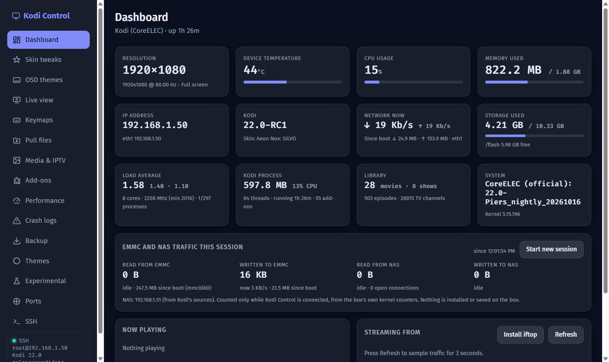<br>Dashboard | 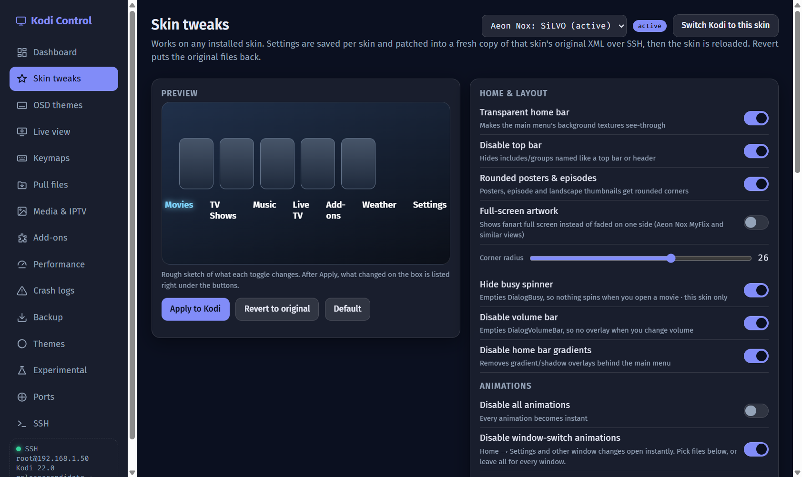<br>Skin tweaks |
| 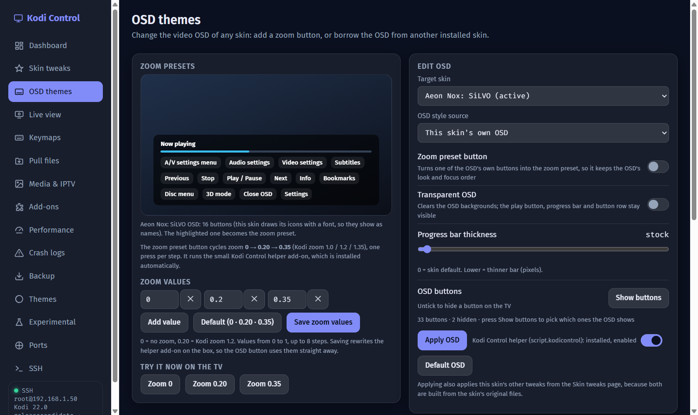<br>OSD themes | 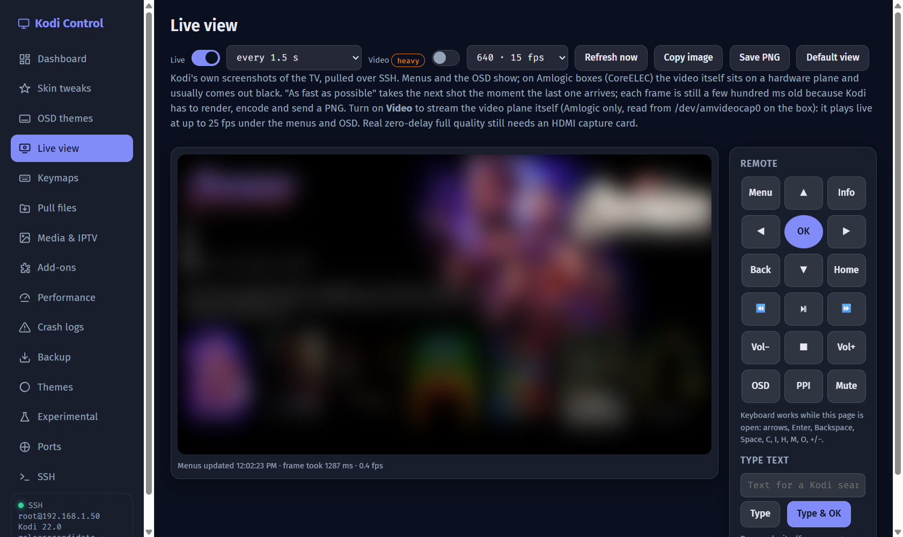<br>Live view |
| 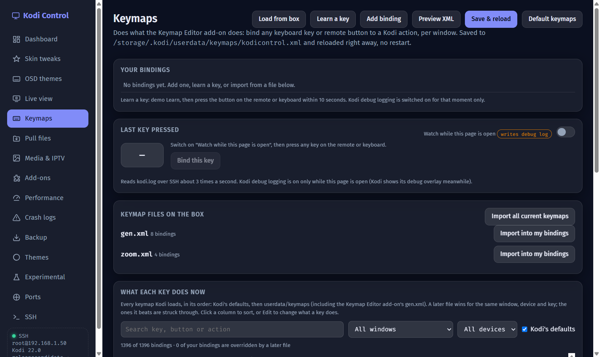<br>Keymaps | 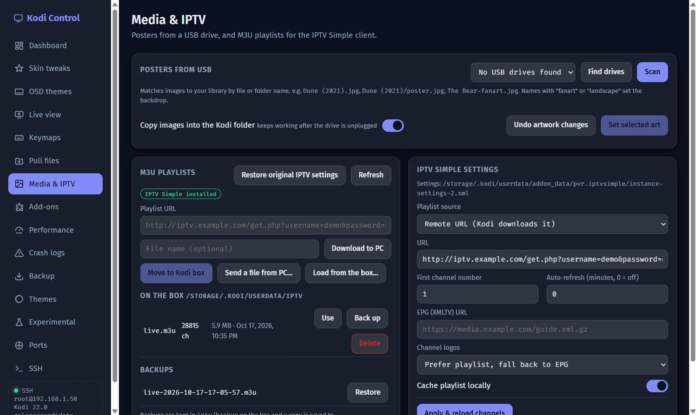<br>Media & IPTV |
| 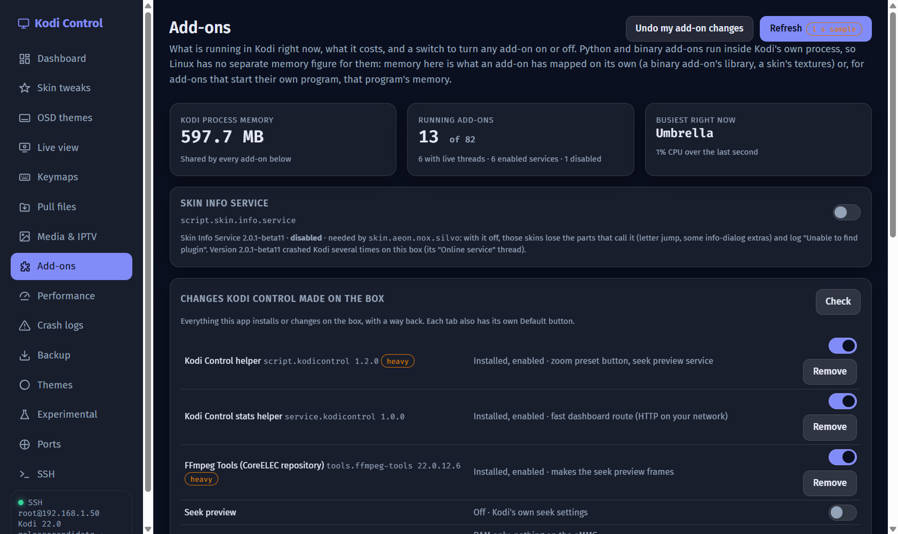<br>Add-ons and the changes list | 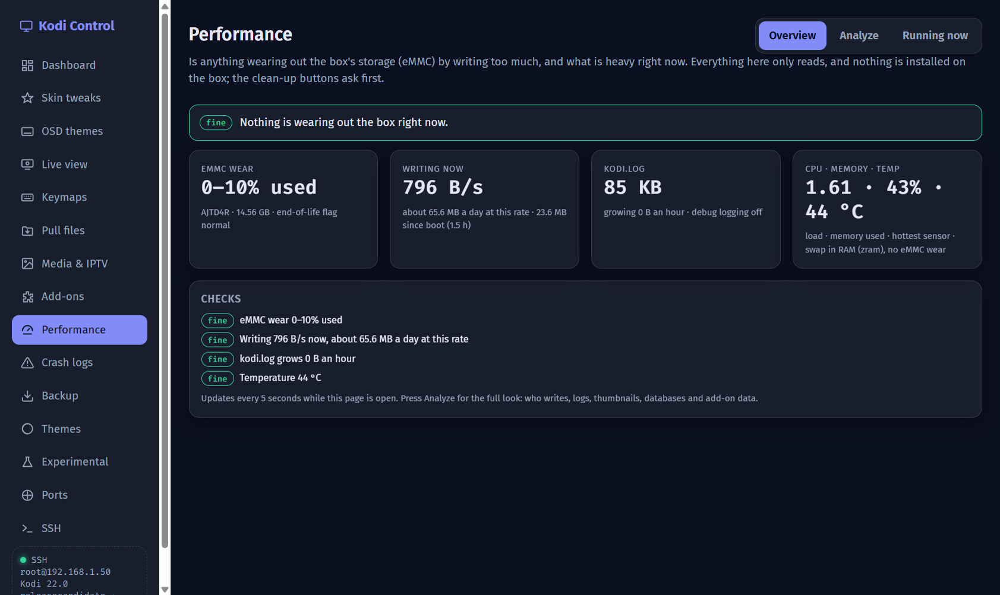<br>Performance |
| 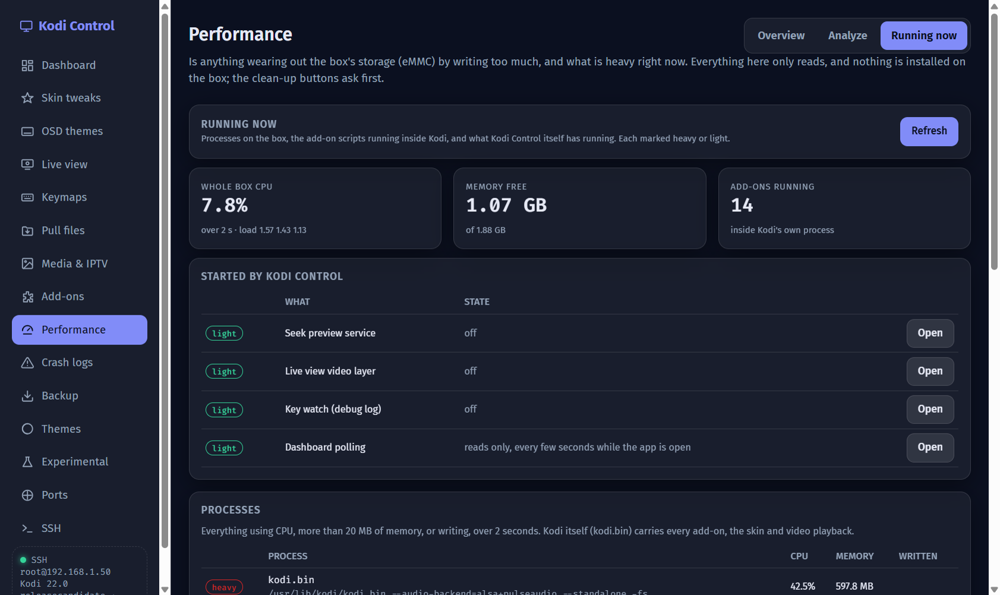<br>Performance: running now | 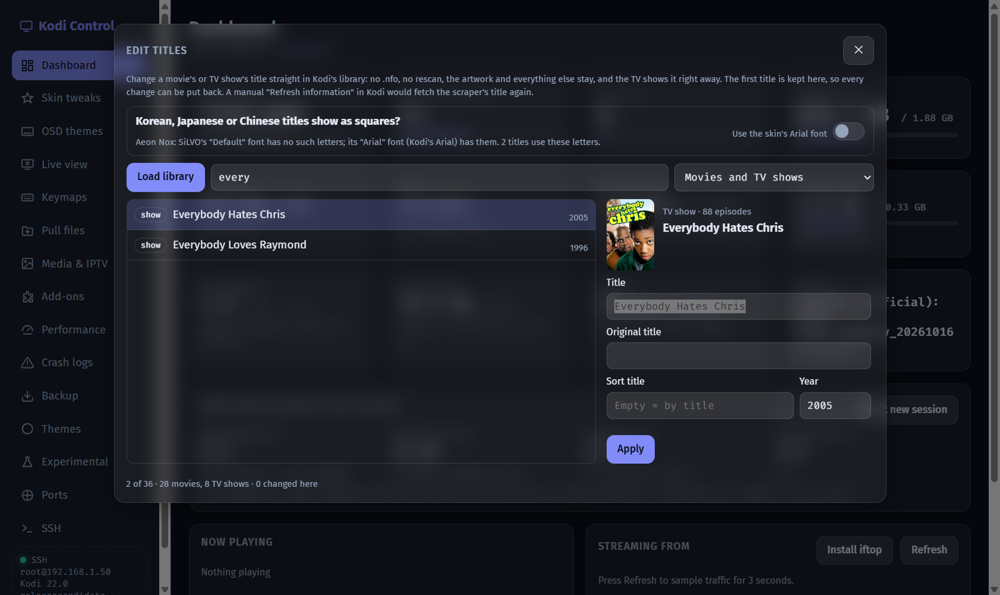<br>Tools: Edit titles |
| 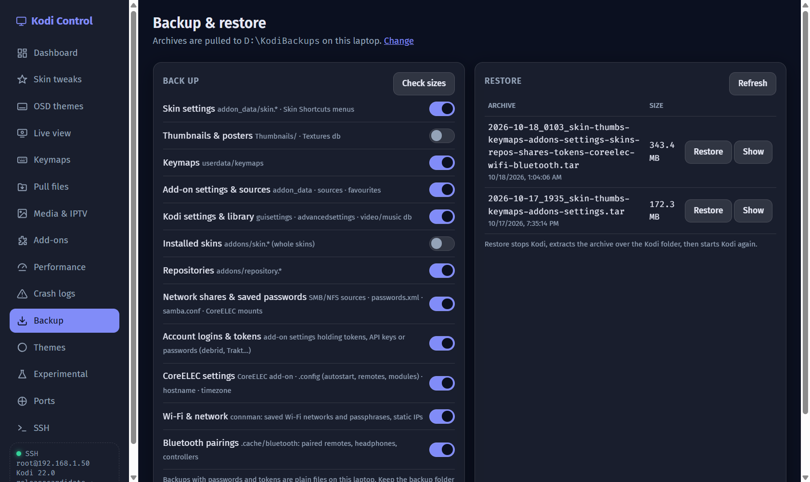<br>Backup & restore | 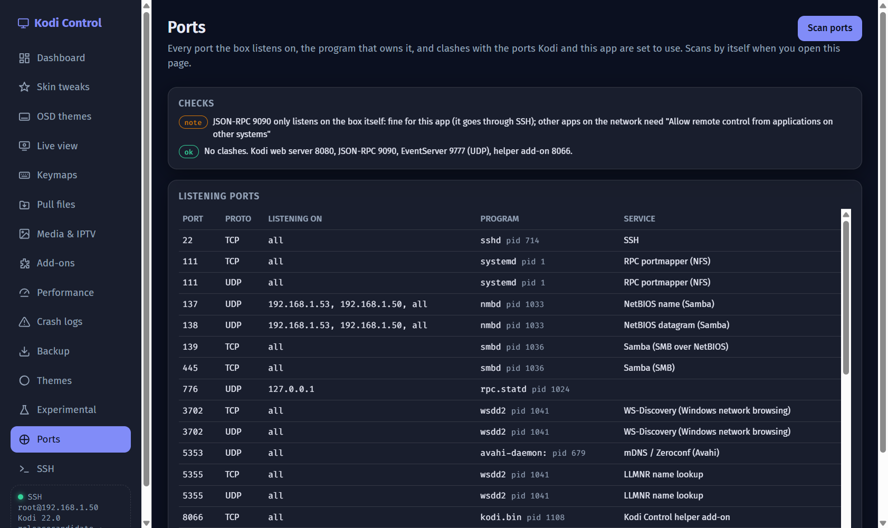<br>Ports |
| 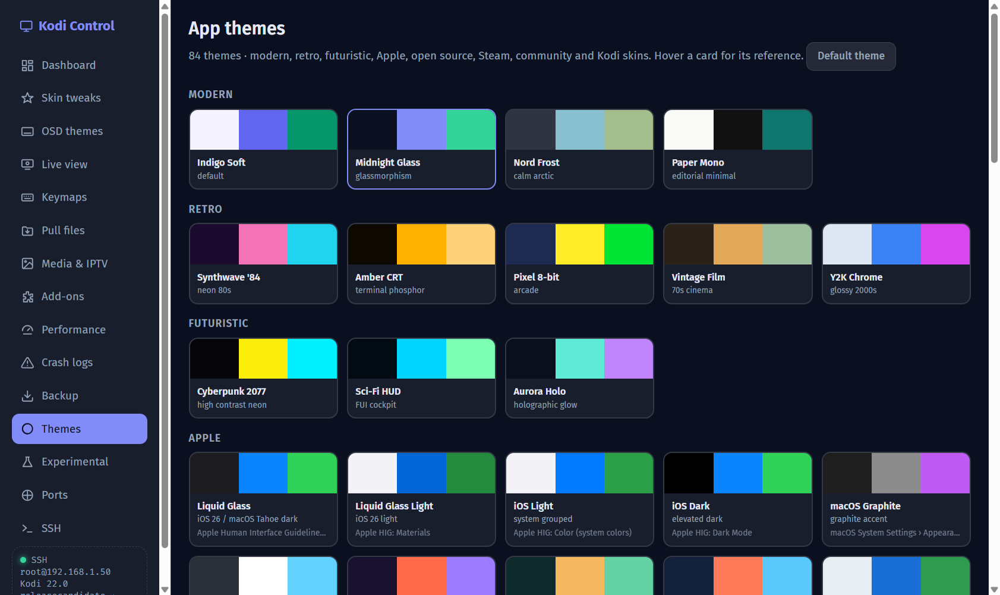<br>Themes | 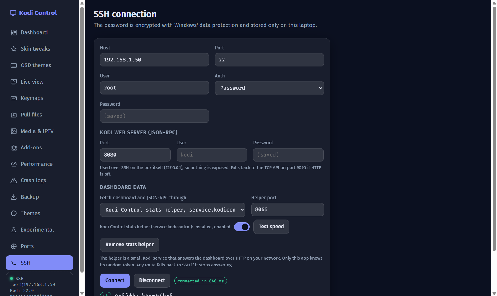<br>SSH connection |

## Features

- **Dashboard.** Shows:
  - Resolution, temperature, CPU, memory, IP address and Kodi version.
  - Live network speed, storage, load average, Kodi's own memory and CPU use, and library counts.
  - What's playing, with its poster, and the full player process info.
  - eMMC read/write and NAS read/write for this session (shown only while connected; nothing runs on the box for it).
- **Streaming from.** Shows which host Kodi is streaming from, labelled by debrid service (Real-Debrid, AllDebrid, Premiumize and others). Uses iftop for per-host speeds, or the whole-box rate without it.
- **Skin tweaks.** Work with any skin, saved per skin:
  - Rounded posters and episode thumbnails.
  - Full-screen artwork, or artwork across the top only with a solid band behind the posters.
  - Transparent home bar, no top bar, faster or no animations.
  - Hide the busy spinner, the volume bar or individual info items.
  - Custom backgrounds.
- **OSD.**
  - Move the whole video OSD from another installed skin, with its fonts, colours, strings and icons. Tested across Aeon Nox SiLVO, Bald, Cupertino, Nimbus, Onyx, Umbrestuary and Estuary.
  - Hide individual OSD buttons, which are shown by name.
  - Zoom preset: turn one of the OSD's own buttons (Info by default, you pick) into a 0 → 0.20 → 0.35 zoom cycle, or add a new button.
  - A preview of the chosen source OSD, with its own icons, and the zoom button highlighted.
  - Editable zoom values.
  - Seek preview (Netflix/Prime style): a frame box above the progress bar while seeking. Needs the FFmpeg Tools add-on; marked **heavy**, because ffmpeg runs on the box during playback.
    - One switch for all of Kodi: it is patched into every skin in your profile at once (built-in skins get it when you switch to them from Kodi Control). It works from the seek bar and from the OSD's own skip buttons, which are turned into step seeks.
    - Switching it off takes it out of every skin and puts the seek delay, seek steps and frame cache back to Kodi's defaults. Its options show only while it is on.
    - Optional RAM-only frame cache: nothing written to the eMMC.
    - Saving seek settings only rewrites the skins when the box's look changed.
    - Subtitles are hidden while the preview box is up and come back after the jump (option, on by default).
- **Keymaps.** An editor for every Kodi window, with key capture from a live "last key" view. Works with the Keymap Editor add-on.
  - The "last key" watch is off by default, because it turns on Kodi debug logging (which writes to the eMMC). It is switched off again when the app closes.
  - Import every current keymap (including the add-on's gen.xml) into your bindings.
  - "What each key does now": every binding Kodi loads, its defaults included, with the file it comes from and the ones a later file overrides. Sort it, filter it by device, and edit any binding with every action the Keymap Editor offers.
- **Live view.** A near-live screenshot of the TV, plus a remote control.
  - Optional live video layer from the Amlogic video plane (about 15 fps), marked **heavy**.
  - Type text into Kodi. A text box pops up by itself whenever Kodi opens its keyboard.
  - Copy the screenshot to the clipboard, or save it.
- **Media & IPTV.**
  - Posters from a USB drive.
  - Download M3U playlists, send them from the PC, or browse the box for them.
  - Back up playlists and set up PVR IPTV Simple.
- **Performance.** Is anything wearing out the box's eMMC? Everything here only reads; clean-up buttons ask first.
  - Overview: eMMC wear (JEDEC life estimate), write rate, CPU, memory, swap, temperature and disk use, refreshed every 5 s.
  - Analyze: samples writes for a chosen time and shows which folders changed, log size and what fills it, thumbnail count and growth (unused and orphaned ones too), databases and add-on data, and what Kodi Control itself keeps on the box. It compares with the previous Analyze.
  - Running now: heavy and light processes, add-ons running inside Kodi, and what Kodi Control has running.
  - Fixes: switch debug logging off, delete old crash logs, delete or move old files to this PC.
- **Logs.** Crash summaries and grouped errors with likely causes.
- **Backup & restore.** Each of these is a separate option:
  - Skin settings, installed skins and repositories.
  - Thumbnails, keymaps, add-on settings, and Kodi settings and library.
  - Network shares and saved passwords, plus add-on logins and tokens.
  - CoreELEC settings, Wi-Fi networks and Bluetooth pairings.
- **Ports.** Every port the box listens on, the program that owns it, and warnings for clashes with Kodi's and this app's ports.
- **Add-ons.** Every running add-on with its threads, CPU and memory, an on/off switch for each, and a dedicated switch for script.skin.info.service.
- **Tools menu.**
  - Edit titles (Ctrl+E): press Load library to list every movie and TV show Kodi has scanned, then change the title, original title, sort title or year. It goes straight into Kodi's library (no .nfo, no rescan, the artwork stays) and the TV shows it right away. The first title is kept, so Put back restores it; all renames are also listed under Add-ons → Changes.
  - Korean, Japanese or Chinese titles showing as squares: the skin's default font has no such letters. The Edit titles window has a switch that moves the skin to its own Arial fontset (Kodi's arial.ttf has them). Nothing is installed, and switching it off puts the old font back.
  - Make local NFO files: next to the media on the box (Kodi's library export), or into a folder on this PC.
  - Screenshot tool (Ctrl+Shift+S) and Copy TV screenshot (Ctrl+Shift+C).
  - Type text into Kodi (Ctrl+T).
- **84 app themes.**
- **Default / Undo everywhere.** Every tab has a Default button: Skin tweaks, OSD themes, zoom values, seek preview, Live view, Keymaps, Keymap Editor settings, Media artwork, IPTV settings, Themes and the stats helper.
  - Add-ons → **Changes Kodi Control made on the box** lists everything the app installed or changed. Each item has an on/off switch where it can be switched (the helper, the stats helper, FFmpeg Tools, the seek preview, the frame cache, each skin's patched files), or a Remove / Put back button.
  - Removing a repository add-on such as FFmpeg Tools keeps a copy inside Kodi Control, so switching it back on needs no download.
  - The SSH and OSD pages show which helper add-on they mean, whether it is installed and enabled, and a switch for it.
  - Heavy features (seek preview, live video, "as fast as possible", key learning, FFmpeg Tools and System Tools installs) ask before they start.

## Install

### Option 1: download the app

1. Download `KodiControl.exe` from the [Releases](../../releases) page.
2. Run it. It's a portable app with nothing to install. Windows SmartScreen may warn about an unknown publisher. Choose **More info → Run anyway**.

### Option 2: build from source

You need [Node.js](https://nodejs.org) 20 or newer, and Git.

```bash
git clone https://github.com/easter478/kodi-control.git
cd kodi-control
npm install
npm run app      # run it straight from source
npm run dist     # build release/KodiControl.exe
npm test         # offline tests (needs Git Bash on Windows)
```

## Set up the Kodi box

1. **Turn on SSH.**
   - CoreELEC / LibreELEC: *Settings → CoreELEC (or LibreELEC) → Services → SSH*. The default user is `root`. Set your own password.
   - OSMC and other Linux: install and enable `openssh-server`.
2. **Turn on JSON-RPC in Kodi.** Go to *Settings → Services → Control*. Turn on **"Allow remote control from applications on this system"**, which is the TCP API on port 9090.
   - Optionally also turn on **"Allow remote control via HTTP"** (the web server on port 8080), with a user name and password.
3. Note the box's IP address. It's under *Settings → System information → Network*.

## Use

1. Open **Connection**. Enter the box's IP, SSH port (22), user (`root`) and password or key file, then press **Connect**. Passwords are encrypted with Windows' own protection (DPAPI) and stay on this PC.
2. The **Dashboard** fills in straight away and refreshes every few seconds.
3. To change how the dashboard fetches its data, use **Connection → Dashboard data**:
   - **SSH tunnel** (default): one open connection, with nothing exposed on the network.
   - **Kodi web server**: straight from the PC. Needs the HTTP option above.
   - **Helper add-on**: press **Install helper add-on**. A small Kodi service answers the whole dashboard in one request. It's protected by a random token that only this app knows.
4. **Skin tweaks.**
   1. Pick a skin and turn on the tweaks you want.
   2. Press **Apply**. The first Apply keeps a pristine copy of the skin on the box, so **Revert** always gets you back.
   3. Kodi reloads the skin.
5. **OSD.**
   1. Choose *OSD source* to borrow another installed skin's OSD.
   2. Press **Load buttons** to tick off buttons you don't want.
   3. Turn on **Zoom preset button** and choose which button becomes the zoom preset.
   4. Press **Apply**.
6. **Backup.**
   1. Tick what to save, then press **Back up now**. Archives go to `D:\KodiBackups`, or *Documents\KodiBackups* if there's no D: drive. You can change this.
   2. To restore, press **Restore** on any archive. Kodi stops, the files go back, and Kodi starts again. Restored Wi-Fi, Bluetooth and CoreELEC settings take effect after a reboot.
   3. Backups with passwords and tokens are plain files, so keep that folder private.

### Testing against your box

`"Kodi Control.exe" --selftest result.json` connects with the saved connection and runs every read-only feature, then writes pass/fail results to `result.json`.

## Notes

- Every change to the box goes over SSH and can be undone: skin patches by **Revert** or **Default**, everything else from its tab's Default button or the changes list on the Add-ons page.
- The OSD transplant copies icons out of the source skin's `Textures.xbt`, unpacking them to PNG.

## License

ISC
